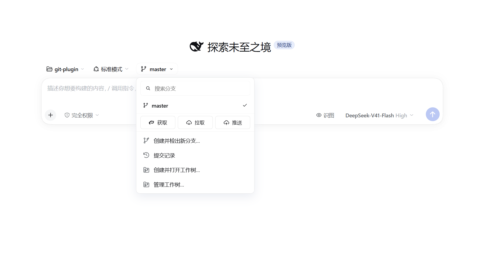
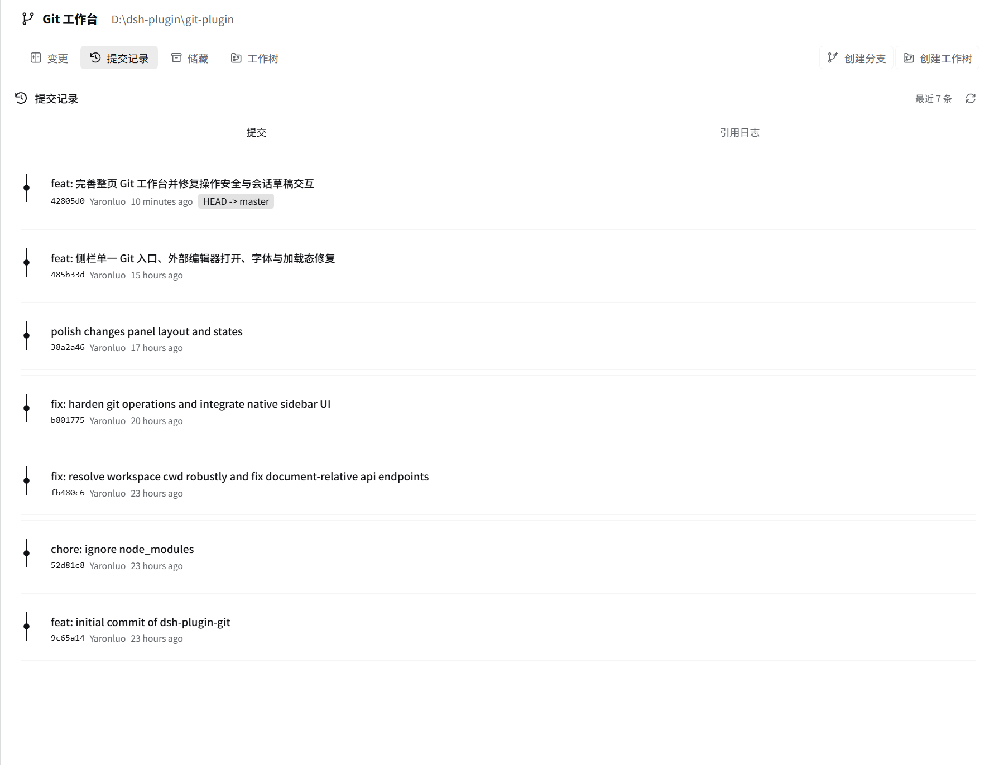

<div align="center">

# DSH Git Workbench

**把 Git 工作流带进 DeepSeek Harness。**

分支切换 · 变更审查 · 提交记录 · 储藏管理 · 多工作树 · AI 草稿协作

[](LICENSE)
[](https://github.com/Yaronluo/dsh-plugin-git-workbench/actions/workflows/ci.yml)
[](#安装)

在对话里写代码，在同一个工作区里看懂、整理并提交改动。

[快速开始](#安装) · [界面预览](#界面预览) · [参与贡献](CONTRIBUTING.md) · [反馈问题](https://github.com/Yaronluo/dsh-plugin-git-workbench/issues)

</div>

> 面向 DeepSeek Harness（DSH）Web GUI / Desktop 的社区开源插件，并非 DeepSeek 官方项目。插件依赖 DSH 宿主接口，不能作为独立网页运行；不同宿主版本的兼容性请以实际测试为准。

## 为什么做这个插件？

AI 编程不止是生成代码，还需要审查差异、挑选提交、切换分支，以及用独立工作树并行探索。DSH Git Workbench 把这些操作放回当前会话，让你少切窗口，也更清楚每一次 Git 操作会影响什么。

## 界面预览

以下五张图片均来自实际项目界面；截图中的仓库路径与提交记录仅作演示，外观可能随 DSH 版本和主题变化。

### 分支入口：从输入框直接进入 Git 工作流

搜索与切换分支，快速获取、拉取、推送，或创建工作树开启新会话。



### 变更工作台：专注当前仓库

与「对话 / 轨迹 / 上下文 / 编队」同排的 Git 页签；工作区干净时清晰呈现空状态，有改动时显示文件列表与差异。


<details open>
<summary><strong>提交记录：回看项目演进</strong></summary>

浏览提交图谱、作者与引用，点开提交查看逐文件差异；也可切换到引用日志。



</details>

<details>
<summary><strong>储藏管理：暂存思路，稍后继续</strong></summary>

保存未提交改动，查看补丁，再选择应用、弹出或删除。


</details>

<details>
<summary><strong>工作树管理：并行开发，各自独立</strong></summary>

查看工作树状态、打开对应会话、在文件管理器中显示目录，以及锁定或安全移除工作树。


</details>

## 核心能力

| 场景 | 能力 |
| --- | --- |
| 分支与同步 | 自动识别 Git 仓库，搜索和切换分支，创建分支，fetch / pull / push，上游与 ahead / behind 信息 |
| 变更审查 | 按冲突、已暂存、未暂存、未跟踪分组；行号、词级高亮、并排差异、上下文与忽略空白 |
| 精细提交 | 文件或 hunk 级暂存 / 取消暂存，提交草稿，amend、Signed-off-by、撤销上次提交 |
| 历史追溯 | 提交图谱、提交详情、逐文件 diff、reflog、文件历史与 blame |
| 储藏与工作树 | 储藏补丁预览与恢复；工作树创建、打开会话、锁定 / 解锁、清理预演 |
| 冲突处理 | 冲突分组、选用当前 / 传入版本，以及进行中 Git 操作的继续 / 中止 / 跳过 |
| 本机工具 | 在编辑器或文件管理器中打开文件、复制路径 / 补丁、仓库内图片预览 |
| 会话协作 | 按会话与仓库保留选择、草稿和滚动位置；提供 8 个 agent Git 工具 |

### AI 帮忙，但由你决定何时发送

「AI 写信息」「AI 审查改动」「注入 Git 上下文」「解释这个文件」只准备提示词草稿：

- 优先打开当前会话的右侧对话并追加草稿，不覆盖已有内容。
- 缺少可用侧边对话时，在同一项目目录新建普通对话并填入草稿。
- **不自动发送、不自动提交、不自动调用模型**；请先检查草稿再手动发送。
- 编写提交信息读取暂存区补丁；审查改动使用当前比较范围。

供 agent 使用的工具：`git_status`、`git_diff`、`git_log`、`git_stage`、`git_unstage`、`git_commit`、`git_stash`、`git_branch`。所有工具都需要明确的 `cwd`。

## 安装

### 环境要求

- 已安装并能运行的 DSH Web GUI / Desktop。插件清单声明 `dsh >=0.2.0-rc.2`，但这不代表所有后续版本都经过验证。
- 本机安装 Git，并确保 `git` 在 DSH 进程的 `PATH` 中可用。
- 从源码构建 / 运行测试：建议 **Node.js 24.2+**、**pnpm 11**。

### npm 安装（推荐）

npm 包名是 **`dsh-plugin-git-workbench`**，已包含构建产物，无需在本地编译。注意：npm 上的 `dsh-plugin-git` 是其他作者的包，并非本项目。

```powershell
dsh plugin --profile desktop add dsh-plugin-git-workbench
```

### GitHub Release 安装

也可直接安装 GitHub Release 提供的预构建包：

```powershell
dsh plugin --profile desktop add https://github.com/Yaronluo/dsh-plugin-git-workbench/releases/latest/download/dsh-plugin-git-workbench.tgz
```

其它 profile 请将 `desktop` 替换为实际名称。按宿主提示重启应用后使用。

### 校验发布来源

`1.0.5` 起，npm 上的包由 GitHub Actions 通过 [npm Trusted Publishing](https://docs.npmjs.com/trusted-publishers)（OIDC）发布：仓库里不再保存长期 npm token，每次发布都由 runner 现场换取一次性凭据；npm 随之附上 **provenance 证明**，记录这个 tarball 由哪个仓库、哪个 workflow、哪个提交构建而来。

想确认手里的包确实来自本仓库，可以查它的证明：

```bash
npm view dsh-plugin-git-workbench dist.attestations
```

把包装进某个项目后，也可以让 npm 校验整棵依赖树的签名：`npm audit signatures`。只有 npm 渠道带证明；GitHub Release 的 tarball 由同一个 tag 触发构建、内容一致，但没有签名。`1.0.4` 及更早的版本是用一次性 token 发布的，没有 provenance。

### 从源码安装

开发和本地调试可使用以下方式：

```bash
git clone https://github.com/Yaronluo/dsh-plugin-git-workbench.git
cd dsh-plugin-git-workbench
pnpm install --frozen-lockfile --ignore-scripts
pnpm build
```

然后将构建后的项目以本地 link 插件加入 DSH Desktop profile。将下面路径替换成你本机克隆目录的绝对路径：

```powershell
dsh plugin --profile desktop add "link:D:\path\to\dsh-plugin-git-workbench"
```

其它 profile 请将 `desktop` 替换为实际名称。安装后按 DSH 提示重启应用，再打开 Git 仓库中的会话，查看 Git 页签与输入框上方的分支入口。

> Host 代码变更需要重新加载插件或完整重启 DSH，单纯刷新网页不会替换正在运行的 Host 服务。客户端修改后也建议构建并刷新；不要假设所有安装方式都支持热更新。

### 外部编辑器

默认探测 `code`、`cursor`、`code-insiders`、`windsurf`、`zed`、`subl`；也可通过启动 DSH 前设置的 `DSH_GIT_EDITOR` 指定编辑器可执行文件。路径含空格时请遵循所在 shell 的引用规则。插件优先使用宿主打开能力，必要时回退到本机应用。

## 开发与测试

```bash
pnpm install --frozen-lockfile --ignore-scripts
pnpm typecheck
pnpm test
pnpm build
```

测试使用 Node 内置测试运行器。Git 写操作测试在临时仓库中运行，不应操作你的真实工作仓库。依赖已安装 DSH / Chromium 的集成测试在环境缺失时会明确跳过；自动测试不等同于当前登录窗口已完成人工验收。

更多测试背景、环境变量与历史回归记录见 [TESTING.md](TESTING.md)。

### 项目结构

```text
src/
├── index.ts       # Host 插件入口
├── core/          # Git 命令、解析与共享类型
├── host/          # Git 服务、HTTP/SSE、agent 工具与本机打开能力
└── client/        # React 工作台、分支胶囊、diff 与会话集成
scripts/           # Host / Client 构建脚本
tests/             # 单元、真实 Git 与可选宿主 / 浏览器回归
docs/screenshots/  # README 界面截图
lib/               # 已构建的插件产物
```

## 安全与使用边界

- 这是可以修改本地仓库的 Git 客户端，不是只读预览器。提交、恢复文件、软重置、储藏删除等操作前，请确认目标仓库与影响范围，重要工作先备份。
- 包含引用 / 路径校验、字面路径处理、冲突守卫与危险操作确认；这些保护不能替代代码审查，也不构成安全保证。
- AI 草稿可能包含代码、路径和差异。发送前请移除密钥和不应交给所选模型服务的内容。
- 凭据由本机 Git 配置及凭据管理器处理，不要把 token 放入仓库或问题反馈中。
- 漏洞报告方式见 [SECURITY.md](SECURITY.md)。

## 参与贡献

欢迎提交问题、兼容性反馈、文档改进和 Pull Request。请提供 DSH / 系统 / Git 版本及可复现步骤；涉及代码或截图时先脱敏。开始前请阅读 [贡献指南](CONTRIBUTING.md)。

## 许可证

本项目代码采用 [MIT License](LICENSE)，Copyright © 2026 Yaronluo。

截图用于展示插件在 DSH 中的集成效果；DeepSeek、DSH 及相关标识归各自权利人所有，代码许可证不授予第三方品牌或商标权。
